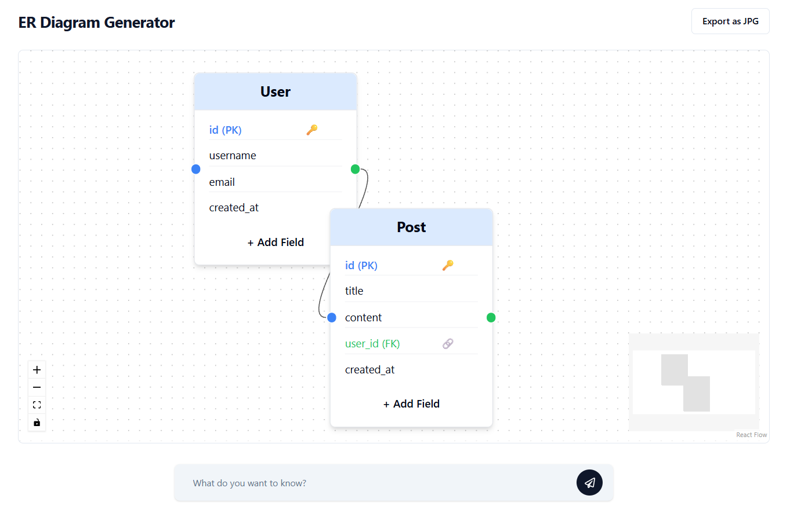
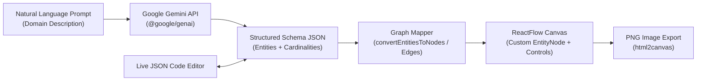
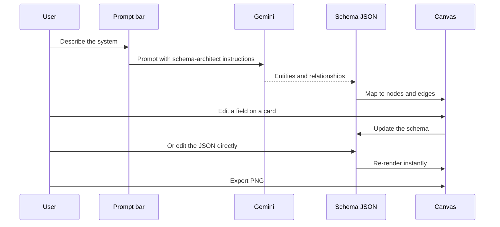
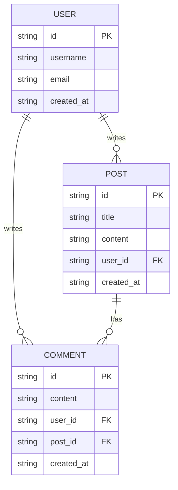

# From a Sentence to a Database Diagram: Building an ER Diagram Generator

*Describe your app in plain English, and get an editable database diagram you can export as an image.*



## TL;DR

- I built a web app that turns a plain-English description of a system into an **Entity-Relationship (ER) diagram**, which is a map of a database's tables and how they connect.
- The AI (Google Gemini) returns a small, strict JSON document. The app draws it on an interactive canvas.
- You can fix the result in two ways: click fields directly on the diagram, or edit the JSON. Both stay in sync.
- One click exports a clean PNG, with editing buttons hidden.

## The problem

Every software project starts with the same question: what information do we need to store, and how does it relate? Say you're building a billing tool. You need organizations, subscriptions, invoices, and invoice line items. An invoice belongs to a subscription, and a subscription belongs to an organization.

Sketching that on paper is easy. Doing it neatly in a diagramming tool is not. You drag boxes, type column names, draw connector lines, and nudge everything so lines don't cross. Then someone says "we forgot a table" and you redo half of it.

I wanted the first draft to cost nothing, so that I could spend my time on the thinking and not on the drawing.

## The idea

Think of an architect with a sketch pad. You describe the building you want, and they hand back a first-draft floor plan in seconds. You then mark it up with a pen.

That's the app. You write something like *"Multi-tenant SaaS billing system with organizations, subscriptions, invoices, and line items"*. An AI plays the architect and drafts the tables, columns, and relationships. You then adjust the draft directly on the canvas.

> **Glossary**
> - **Entity**: a thing you store data about (User, Post, Invoice). It usually becomes a database table.
> - **Attribute**: a property of an entity (email, title). It usually becomes a column.
> - **PK (primary key)**: the column that uniquely identifies each row.
> - **FK (foreign key)**: a column that points to a row in another table.
> - **Cardinality**: how many of one thing relate to another. `1:N` means one user has many posts.

## How it works



In plain English:

1. **You describe your system** in a text box.
2. **Gemini drafts the schema.** It identifies the tables, marks primary and foreign keys, and decides how tables relate (`1:1`, `1:N`, `N:1`, or `M:N`).
3. **The draft is stored as JSON**, a compact, readable format that is the single source of truth.
4. **A mapper turns the JSON into boxes and lines** on an interactive canvas.
5. **You refine it.** Click a column on any table card to rename or remove it, or add a new one. You can also edit the JSON in a live editor and the diagram redraws instantly.
6. **Export** to PNG when you're happy.

Along the way, you can pan, zoom, use a minimap, drag tables around, and wire up new connections between tables by hand. Primary keys (`PK`) and foreign keys (`FK`) get distinct visual badges so they're easy to spot.

### What happens when you edit



## Under the hood

> **For the curious:** This section is for technical readers. If you only want to try the app, skip to "Try it yourself".

### The contract is the product

The app's central design decision is a small JSON contract. Both the Gemini pipeline and the live JSON editor read and write this same shape:

```json
{
  "entities": [
    {
      "id": "1",
      "name": "User",
      "attributes": ["id (PK)", "username", "email", "created_at"]
    },
    {
      "id": "2",
      "name": "Post",
      "attributes": ["id (PK)", "title", "content", "user_id (FK)", "created_at"]
    },
    {
      "id": "3",
      "name": "Comment",
      "attributes": ["id (PK)", "content", "user_id (FK)", "post_id (FK)", "created_at"]
    }
  ],
  "relationships": [
    { "id": "r1", "source": "1", "target": "2", "label": "1:N" },
    { "id": "r2", "source": "1", "target": "3", "label": "1:N" },
    { "id": "r3", "source": "2", "target": "3", "label": "1:N" }
  ]
}
```

| Field | Type | Description |
| :--- | :--- | :--- |
| `entities[].id` | `string` | Unique identifier referenced by relationship edges |
| `entities[].name` | `string` | Relational table / entity name |
| `entities[].attributes` | `string[]` | Column names annotated with `(PK)` or `(FK)` where applicable |
| `relationships[].source` | `string` | Source entity `id` |
| `relationships[].target` | `string` | Target entity `id` |
| `relationships[].label` | `string` | Cardinality notation (`1:1`, `1:N`, `N:1`, `M:N`) |

The example above, drawn as a data model:



### Key design decisions and why

- **Structured JSON from the model, not free text.** Gemini is used with a structured-JSON approach and a deterministic schema-architect system prompt. A strict shape means the app can render the output without fragile text parsing.
- **One source of truth.** Because the canvas and the JSON editor share one schema, edits flow both ways. Switching between "visual" and "code" never loses work.
- **A thin mapper layer.** Functions like `convertEntitiesToNodes` and its edge counterpart translate the schema into ReactFlow nodes and edges. The data model stays independent of the rendering library.
- **Attributes as annotated strings.** Writing `user_id (FK)` is less formal than a full column object, but it's easy for both a model and a human to produce and read. The trade-off is that the app relies on a text convention instead of richer typed metadata (such as column data types).
- **Export that hides the UI.** `html2canvas` rasterizes the canvas. Before capture, the app hides interactive controls (`+ Add Field`, delete buttons), so the exported image is presentation-ready.

### Project layout

```text
er-diagram-generator/
├── images/
│   └── image.png                 # Application workspace preview
├── src/
│   ├── components/
│   │   ├── EntityNode.tsx        # Custom ReactFlow node with inline PK/FK field editing
│   │   └── ui/                   # Radix UI + shadcn/ui primitives
│   ├── pages/
│   │   ├── Index.tsx             # Prompt bar, Gemini integration, JSON editor & ReactFlow canvas
│   │   └── NotFound.tsx          # Fallback route
│   ├── App.tsx                   # Router & toast notification shell
│   └── main.tsx                  # Application entrypoint
├── package.json
└── vite.config.ts
```

### Tech stack

| Layer | Choice |
| :--- | :--- |
| Frontend | React 18, TypeScript, Vite |
| Graph visualization | ReactFlow (`reactflow`) |
| AI / schema generation | Google GenAI SDK (`@google/genai`, Gemini) |
| Styling and UI | Tailwind CSS, Radix UI, shadcn/ui, Lucide Icons |
| Export | `html2canvas` |

## Results and what I learned

I'm not going to quote benchmarks I didn't measure. What the project delivers:

- A working path from a one-sentence description to a draft diagram, with relationships tagged as `1:1`, `1:N`, `N:1`, or `M:N`.
- Two-way editing between a visual canvas and a JSON editor.
- PNG export that leaves editing controls out of the picture.

What I learned:

- **A small, strict data format makes AI output usable.** Most of the reliability comes from constraining what the model may return.
- **Letting people correct the AI matters more than making the AI perfect.** A draft that takes ten seconds to fix beats a blank canvas.
- **Keep data and drawing separate.** The mapper layer keeps the schema readable and easy to edit by hand.

## Try it yourself

**Prerequisites:** Node.js 18+ (or Bun), and a Google Gemini API key from [Google AI Studio](https://aistudio.google.com/).

**1. Clone and install**

```bash
git clone https://github.com/AbQaadir/er-diagram-generator.git
cd er-diagram-generator
npm install
```

**2. Add your key.** Create a `.env` file in the project root:

```env
VITE_GEMINI_API_KEY=your_gemini_api_key_here
```

**3. Run it**

```bash
npm run dev
```

Open `http://localhost:5173`, type a system description in the prompt input (or paste custom JSON directly), and export your diagram.

> **Heads up:** Vite exposes `VITE_`-prefixed variables to the browser, so the key is available client-side. Use a personal key for local experiments.

## What's next

Honest limitations of the current version:

- Attributes are plain annotated strings, so there are no column data types or constraints.
- Output quality depends on how clearly the domain is described. Always review the draft.
- The API key setup is aimed at local use, not a public deployment.

## Links

- Source: [github.com/AbQaadir/er-diagram-generator](https://github.com/AbQaadir/er-diagram-generator)
- Gemini API keys: [Google AI Studio](https://aistudio.google.com/)
- License: [MIT](https://opensource.org/licenses/MIT)
