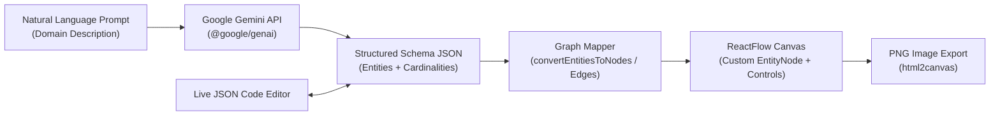

# ER Diagram Generator — Natural Language to Interactive Database Schemas

[](https://www.typescriptlang.org/)
[](https://react.dev/)
[](https://reactflow.dev/)
[](https://ai.google.dev/)
[](https://vitejs.dev/)
[](https://opensource.org/licenses/MIT)

An interactive schema design web application that converts natural language domain descriptions into editable, exportable **Entity-Relationship (ER) diagrams** on an interactive node-graph canvas.

Instead of manually drawing boxes and crow's-foot connectors from scratch, describe your application domain in plain English (for example, *"Multi-tenant SaaS billing system with organizations, subscriptions, invoices, and line items"*), refine entities and attributes inline on the **ReactFlow** canvas or in the live JSON schema editor, and export clean diagrams as PNG images.


---

## Key Capabilities

- **Natural Language Schema Synthesis**: Uses the Google Gemini SDK (`@google/genai`) with a deterministic schema-architect system prompt to identify relational tables, primary keys (`PK`), foreign keys (`FK`), and relationship cardinalities (`1:1`, `1:N`, `N:1`, `M:N`).
- **Bidirectional JSON & Visual Canvas**: Edit schemas directly in the JSON editor and re-render instantaneously, or click attributes directly inside any `EntityNode` card on the canvas to add, rename, or remove columns inline.
- **Visual Key Indicators**: Automatically highlights `(PK)` primary keys and `(FK)` foreign keys with distinct visual badges and left/right connection handles.
- **Interactive Graph Controls**: Full pan, zoom, minimap navigation, manual edge wiring between entities, and layout dragging powered by `reactflow`.
- **Clean Diagram Export**: One-click PNG export via `html2canvas` that automatically hides interactive UI controls (`+ Add Field`, delete buttons) prior to rasterization so exported diagrams stay presentation-ready.

---

## Architecture Flow



---

## Structured Schema Specification

Both the Gemini prompt pipeline and the live JSON editor operate on a concise, human-readable relational JSON contract:

```json
{
  "entities": [
    {
      "id": "1",
      "name": "User",
      "attributes": ["id (PK)", "username", "email", "created_at"]
    },
    {
      "id": "2",
      "name": "Post",
      "attributes": ["id (PK)", "title", "content", "user_id (FK)", "created_at"]
    },
    {
      "id": "3",
      "name": "Comment",
      "attributes": ["id (PK)", "content", "user_id (FK)", "post_id (FK)", "created_at"]
    }
  ],
  "relationships": [
    { "id": "r1", "source": "1", "target": "2", "label": "1:N" },
    { "id": "r2", "source": "1", "target": "3", "label": "1:N" },
    { "id": "r3", "source": "2", "target": "3", "label": "1:N" }
  ]
}
```

| Field | Type | Description |
| :--- | :--- | :--- |
| `entities[].id` | `string` | Unique identifier referenced by relationship edges |
| `entities[].name` | `string` | Relational table / entity name |
| `entities[].attributes` | `string[]` | Column names annotated with `(PK)` or `(FK)` where applicable |
| `relationships[].source` | `string` | Source entity `id` |
| `relationships[].target` | `string` | Target entity `id` |
| `relationships[].label` | `string` | Cardinality notation (`1:1`, `1:N`, `N:1`, `M:N`) |

---

## Project Structure

```text
er-diagram-generator/
├── images/
│   └── image.png                 # Application workspace preview
├── src/
│   ├── components/
│   │   ├── EntityNode.tsx        # Custom ReactFlow node with inline PK/FK field editing
│   │   └── ui/                   # Radix UI + shadcn/ui primitives
│   ├── pages/
│   │   ├── Index.tsx             # Prompt bar, Gemini integration, JSON editor & ReactFlow canvas
│   │   └── NotFound.tsx          # Fallback route
│   ├── App.tsx                   # Router & toast notification shell
│   └── main.tsx                  # Application entrypoint
├── package.json
└── vite.config.ts
```

---

## Getting Started Locally

### Prerequisites
- **Node.js** 18+ (or **Bun**)
- A **Google Gemini API Key** from [Google AI Studio](https://aistudio.google.com/)

### 1. Clone & Install

```bash
git clone https://github.com/AbQaadir/er-diagram-generator.git
cd er-diagram-generator
npm install
```

### 2. Configure Environment

Create a `.env` file in the project root:

```env
VITE_GEMINI_API_KEY=your_gemini_api_key_here
```

### 3. Run Development Server

```bash
npm run dev
```

Open `http://localhost:5173` in your browser, enter a system description in the prompt input (or paste custom JSON directly), and export your diagram!

---

## Tech Stack

- **Frontend**: React 18, TypeScript, Vite
- **Graph Visualization**: ReactFlow (`reactflow`)
- **AI / Schema Generation**: Google GenAI SDK (`@google/genai` — Gemini)
- **Styling & UI**: Tailwind CSS, Radix UI, shadcn/ui, Lucide Icons
- **Export**: `html2canvas`

---

## License

Released under the [MIT License](https://opensource.org/licenses/MIT).
